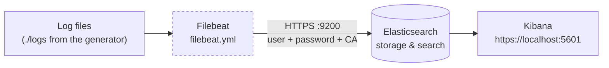

# Minimal SIEM

A minimal Elastic stack for the classroom: Elasticsearch to store, Kibana to explore. Log files come from a generator and reach Elasticsearch through a Filebeat.



## Requirements

- Docker with Compose, 4 GB of free RAM, ports 9200 and 5601 free.
- Works on Linux

## Start

```bash
cp .env.example .env
```

Edit `.env`: set `ELASTIC_PASSWORD` and `KIBANA_PASSWORD`, and replace the three `KIBANA_*_KEY` placeholders with the output of `openssl rand -hex 32` (run it three times).

```bash
docker compose up -d
docker compose ps        # wait until es01 and kibana are "healthy" (about one minute)
```

Kibana: **https://localhost:5601**, user `elastic`, the password you set. The certificate is self-signed, accept the browser warning.

## Connecting your Filebeat

Elasticsearch listens on `https://localhost:9200` with its own certificate authority. Your `filebeat.yml` needs three things in `output.elasticsearch`: the URL, the `elastic` credentials, and the CA file. Extract the CA from the running container:

```bash
docker cp minimal-siem-es01:/usr/share/elasticsearch/config/certs/ca/ca.crt ./ca.crt
```

Everything else, which files to read, how to parse them, which index to write to, is up to you. In Kibana, create a Data View (*Stack Management -> Data Views*) matching your
index to see the data in *Discover*.
